<a href="https://amaann190.github.io"></a>

<br>

I'm Amaan. I work on payments data, the unglamorous part where money moves between a merchant, a gateway and a bank, and someone has to prove it all lines up.

Most of what I build starts with a messy source and a question a finance team would actually ask. Did this payout land? Which bank is failing the most people? Why is this account sending money in a circle? I clean the data, model it in Python and SQL, check the answer against ground truth with tests, and ship a dashboard someone could act on Monday morning.

Right now I'm looking for a **fintech analyst internship** in payments, risk, reconciliation or AML ops.

<br>

<a href="https://github.com/Amaann190/aml-graph-intelligence"></a>

<br>

## Ledger

<a href="https://github.com/Amaann190/aml-graph-intelligence"></a>
<a href="https://github.com/Amaann190/merchant-settlement-reconciliation"></a>
<a href="https://github.com/Amaann190/upi-reliability-intelligence"></a>

<sub>Datasets are labelled honestly: AML and reconciliation run on synthetic data with ground truth, UPI uses NPCI's published statistics. The monitor above is a simulated feed.</sub>

<br><br>

## How a project moves



```diff
+ reconcile to the paisa        totals get checked, never trusted
+ rate is not impact            5.89% at a rural bank vs 0.57% at SBI: SBI still fails more people
+ test it like software         64+ pytest tests across three repos
+ say what the data is          synthetic is called synthetic
- "the dashboard looks right"
```

## Toolbox


`pandas` `NetworkX` `Power BI` `DAX` `Streamlit` `pytest`

## Commit trail


## Reach me

[amaanshk190@gmail.com](mailto:amaanshk190@gmail.com) &nbsp;/&nbsp; [amaann190.github.io](https://amaann190.github.io)

<br>


<p align="right"><sub><code>closing balance: ₹0.00 unaccounted for</code></sub></p>
